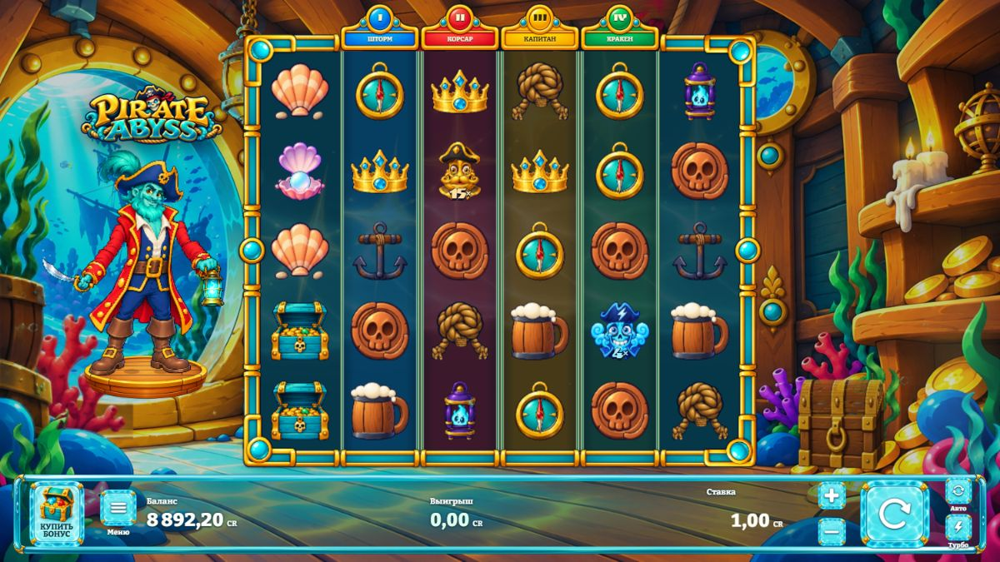
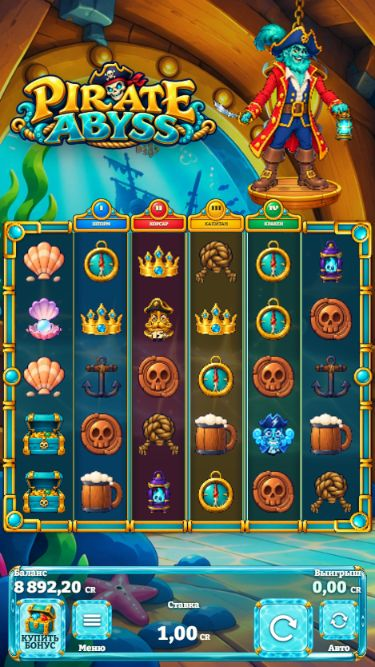

# Pirate Abyss

A cartoon pirate slot frontend with a 6 × 5 reel grid, 19 paylines, expanding Wilds, free-spin features, an animated captain and an underwater cabin.



This source showcase is based on version **1.26.4** with its corresponding runtime assets. The screenshots document a prior v41 visual review; they are examples of the interface rather than certification of every current behavior.

## Stack and features

- React 19, TypeScript, Vite 7, PixiJS 7 and Spine 4.2.
- Canvas/WebGL rendering, retained renderers and shared animated reel-curtain layers.
- Symbol idle/drop/win animation states, character reactions, bonus transitions and win presentations.
- Responsive controls, loading and welcome screens, an asset inspection gallery and English/Russian text.
- RGS launch and response validation, round recovery, replay, jurisdiction flags and selected engine/session tests.

## Build and inspect

Use Node.js 24 or newer:

```sh
npm ci
npm run build
npm test
npm run dev
```

**This checkout is not a complete playable local demo.** Normal local initialization loads catalogs from `public/alchemist/math/`; those catalogs and all full outcome books are deliberately omitted. Source and runtime assets can be inspected and compiled, but a normal local game session requires matching original math data. A hosted RGS session additionally needs authorized launch parameters. No credentials or production endpoint configuration are supplied.

This repository does not establish platform approval, certified RTP or live real-money operation. The engine reconstructs publicly described game rules using local parameters; it does not contain the reference game's proprietary server mathematics, media or reel strips. Generated mathematical book corpora, source-art archives and private review reports are excluded.



## Rights and credits

See [LICENSE_NOTICE.md](LICENSE_NOTICE.md) and [LICENSES](LICENSES). Current music includes **Adventure** and **Jolly Good, Captain** by **Alexander Nakarada**, licensed under **CC BY 4.0**; retained [music credits](public/alchemist/audio/CREDITS-v42.html) describe the loop edits and attribution. Kenney sound effects are CC0. Fonts and Spine retain their own licenses. Raster illustrations were prepared with AI-assisted workflows. No open-source license is granted for the project-specific code or proprietary artwork.
